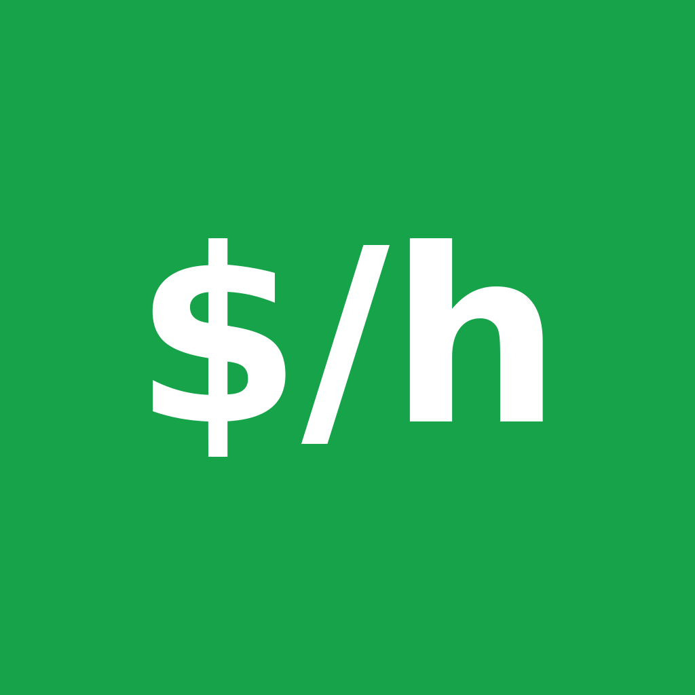

<p align="center">
  
</p>

<h1 align="center">Freelance Rate Calculator</h1>

<p align="center">
  Find the hourly rate you actually need after platform fees, taxes and expenses.<br>
  A private, offline Android app built with Expo and React Native.
</p>

<p align="center">
  
  
  
  
  <a href="LICENSE"></a>
</p>

---

## Why

Many freelancers set their rate by guessing, then lose a large share of it to platform fees, taxes, tools and unpaid admin time. Freelance Rate Calculator starts from the income you want to take home and works backwards to the **minimum hourly rate** you need to charge.

## Features

- **Live rate calculator**: minimum hourly rate, daily rate and monthly gross, updated as you type
- **Accounts for reality**: vacation and holiday days, non-billable time (admin, proposals, learning), tax rate, business expenses and a profit/safety margin
- **Platform fee presets**: Upwork 10%, Fiverr 20% or Direct 0%, or any custom value
- **Breakdown bar**: shows how much of each month's gross goes to you, taxes, expenses, margin and platform fees
- **Project estimator**: turns estimated hours plus a buffer into a project price, shows what the client pays versus what you receive, and suggests a rounded fixed price
- **Copy quote**: puts a short quote summary on the clipboard in one tap
- **Presets**: save setups for different platforms or clients and load them in one tap
- **Currencies**: USD, EUR, GBP, TND or a custom symbol
- **Light and dark mode** that follows your system setting

## Privacy

- No account, no backend and no network requests
- No analytics, no ads and no third-party services
- **No Android permissions**: `app.json` sets `"permissions": []` and also blocks permissions that libraries add by default
- Inputs and presets are stored only on the device (AsyncStorage)

Read the full [privacy policy](https://elwessdev.github.io/PriceMyHour/privacy-policy.html).

## How the rate is calculated

```text
working_days_per_year   = working_days_per_week × 52 − vacation_days
billable_hours_per_year = working_days_per_year × hours_per_day × (1 − non_billable% / 100)
gross_needed            = (monthly_income × 12) / (1 − tax% / 100) + monthly_expenses × 12
with_margin             = gross_needed × (1 + margin% / 100)
before_platform_fee     = with_margin / (1 − platform_fee% / 100)
minimum_hourly_rate     = before_platform_fee / billable_hours_per_year
daily_rate              = minimum_hourly_rate × hours_per_day
```

With the default inputs (2,000 net per month, 6 billable hours per day, 5 days per week, 20 vacation days, 25% non-billable time, 10% platform fee, 15% tax, 100 monthly expenses and a 10% margin), the minimum rate is **$33.31/h**.

The logic is a pure function in [`lib/calc.ts`](lib/calc.ts) with Jest tests. Inputs that would divide by zero or give a meaningless result show an inline error, so the app never displays `NaN` or `Infinity`. Examples are 0 hours, a 100% fee or tax rate, more vacation than working days, and empty fields.

## Getting started

### Requirements

- [Node.js](https://nodejs.org/) 20 or newer
- The [Expo Go](https://expo.dev/go) app on an Android phone, or an Android emulator from Android Studio

### Run the app

```bash
git clone https://github.com/elwessdev/PriceMyHour.git
cd PriceMyHour
npm install
npx expo start
```

Scan the QR code with Expo Go, or press `a` to open the app in a running Android emulator. If your phone can't connect over Wi-Fi, use `npx expo start --tunnel`.

### Tests and type check

```bash
npm test            # Jest unit tests for the calculation and formatting logic
npm run typecheck   # TypeScript strict mode
```

## Building a release (.aab)

Release builds use [EAS Build](https://docs.expo.dev/build/introduction/). The `production` profile in [`eas.json`](eas.json) produces an Android App Bundle for Google Play.

```bash
npm i -g eas-cli
eas login
eas build -p android --profile production
```

On the first build, let EAS generate and manage the Android keystore. Before each new release, increase `version` and `android.versionCode` in [`app.json`](app.json).

> **Note:** `app.json` blocks `android.permission.INTERNET` so the store build requests no permissions. This doesn't affect Expo Go. A custom development build (`--profile development`) needs INTERNET to reach the Metro bundler, so remove it from `blockedPermissions` while you use one.

## Project structure

```text
app/                    Routes (expo-router)
  _layout.tsx           Root layout: providers, splash screen, status bar
  (tabs)/               Bottom tabs: Calculator, Project, Presets, About
components/             UI components and the shared app state provider
lib/
  calc.ts               Rate and project calculations with validation (pure, unit-tested)
  format.ts             Currency and number formatting and parsing
  storage.ts            Local persistence for last-used inputs and presets
constants/theme.ts      Light and dark colours, spacing, typography
__tests__/              Jest tests
assets/                 App icon, adaptive icon and splash image
scripts/                Asset generator (Python + Pillow)
privacy-policy.html     Standalone privacy policy page (served with GitHub Pages)
store-listing/          Google Play listing text
```

## Tech stack

- [Expo](https://expo.dev/) SDK 58 and [React Native](https://reactnative.dev/) 0.88
- [Expo Router](https://docs.expo.dev/router/introduction/) for tab navigation
- [AsyncStorage](https://react-native-async-storage.github.io/async-storage/) for on-device storage
- [expo-clipboard](https://docs.expo.dev/versions/latest/sdk/clipboard/) for copying quotes
- TypeScript in strict mode, with Jest and `jest-expo` for tests

There is no UI kit, icon font or chart library. The breakdown bar and tab icons use plain React Native views and text.

### Regenerating the icons

The placeholder icon, adaptive icon, splash image and 512×512 Play Store icon are generated by a script (requires Python 3 and Pillow):

```bash
npm run assets
```

## Contributing

Bug reports and suggestions are welcome. Please [open an issue](https://github.com/elwessdev/PriceMyHour/issues). For pull requests, run `npm test` and `npm run typecheck` before submitting.

## License

Released under the [MIT License](LICENSE).

## Disclaimer

The app gives estimates only. It is not financial or tax advice.
